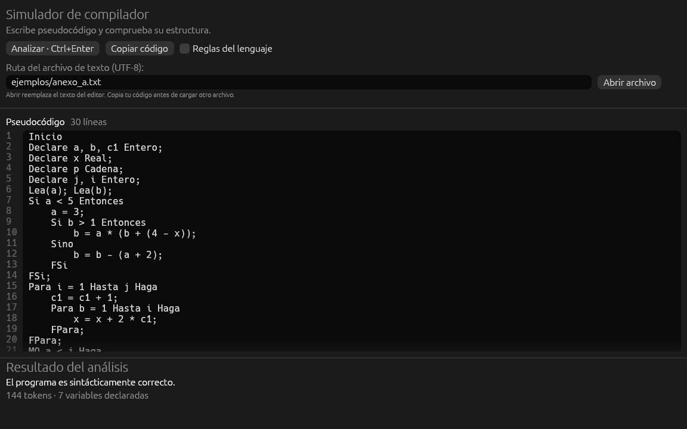
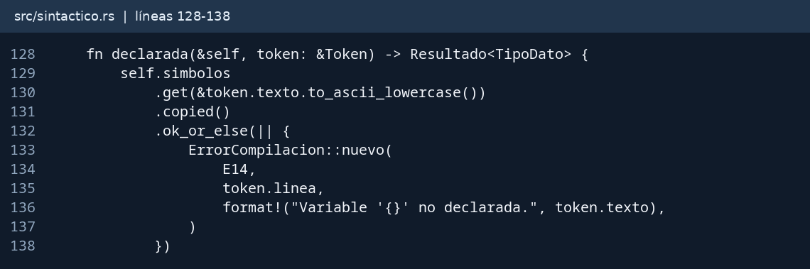
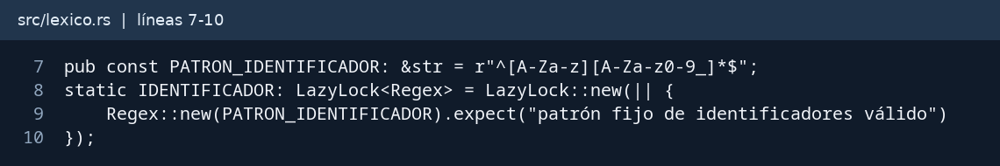
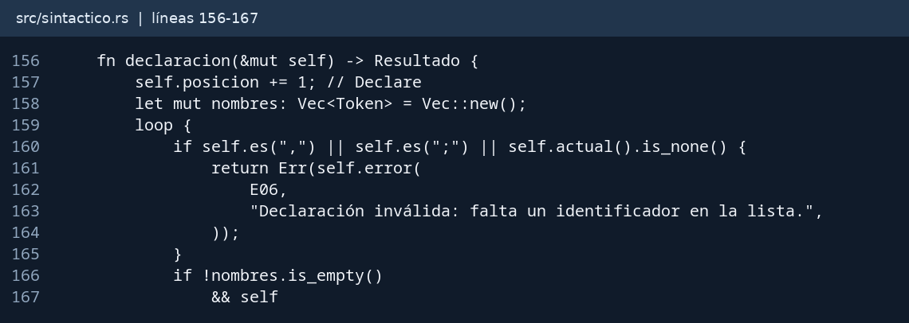
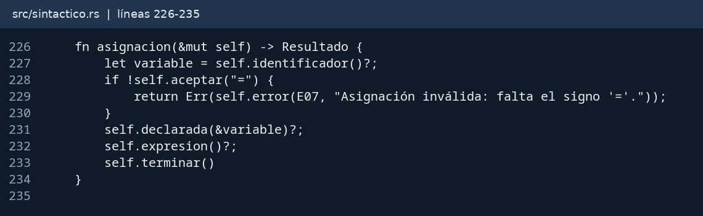
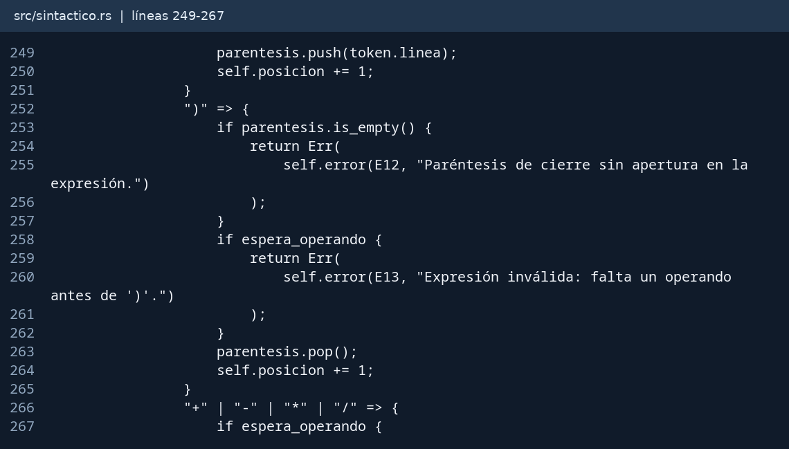
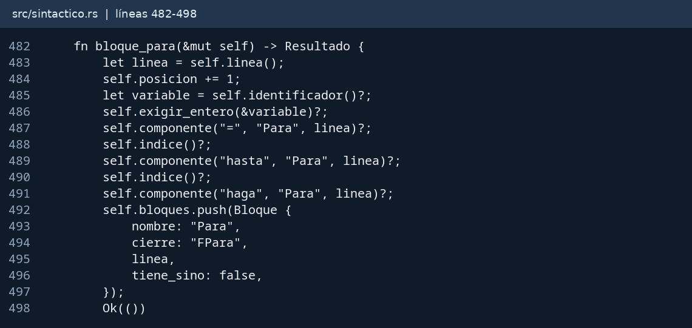
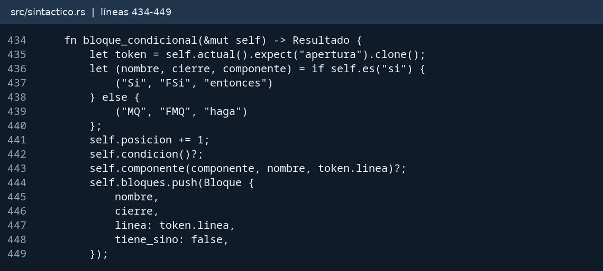

# Simulación de un compilador
## 1. Fundamento, alcance y elección de Rust

El proyecto valida el pseudocódigo de la especificación del II Proyecto de Autómatas, Gramáticas y Lenguajes. Recibe texto escrito o cargado desde un archivo y responde si cumple las reglas. Cuando falla, informa un código, un tipo, una línea y una causa. Se implementó con asistencia de IA; este informe describe el software y sus verificaciones, sin atribuir autoría exclusiva ni inventar experiencias del estudiante.

Un compilador completo transforma un lenguaje fuente en otro lenguaje o en código ejecutable. Esta aplicación implementa parte de su frente de análisis. El análisis léxico agrupa caracteres en tokens; el sintáctico reconoce la estructura que permite la gramática; las comprobaciones semánticas comprueban declaraciones previas, duplicados y tipos Entero del Para. La aplicación no ejecuta el pseudocódigo ni genera código objeto. Lea y Escriba solo se validan; no hay consola ni entrada interactiva.

La gramática describe cómo se combinan sentencias, expresiones y bloques. Las expresiones admiten identificadores, números, cuatro operadores y agrupación. Se reconoce su forma sin construir un árbol ni calcular resultados: la precedencia no cambia qué secuencias son válidas. Los bloques requieren una pila porque el último abierto debe cerrarse primero, incluso al mezclar Si, MQ y Para.

Rust permite representar tokens y errores mediante struct y enum, conservar tipos explícitos y propagar fallos con Result. Cargo organiza dependencias y pruebas; Cargo.lock fija sus versiones. Su compilación nativa sirve para una aplicación local. Como dificultad inicial, su propiedad y préstamos requieren distinguir datos conservados por el editor de referencias temporales. eframe/egui proporcionan la ventana y los controles, mientras regex satisface la validación explícita de identificadores.

La biblioteca separa lexico, sintactico, errores y archivos. La ventana conserva el texto, llama al mismo motor que la terminal y muestra su resultado. El programa del anexo se acepta sin ejecutar sus instrucciones.

<!-- pagina -->

# 2. Variables no declaradas

Requisitos: RF-08, RF-09 y RF-26. La tabla de símbolos es un BTreeMap de nombres a TipoDato. Los nombres se normalizan a minúsculas ASCII; por eso A y a designan la misma variable. La tabla se crea de nuevo para cada análisis, sin arrastrar declaraciones de un programa anterior.

Parser::declarada consulta la tabla y devuelve el tipo o un error E14 con la línea del token usado. La llaman las asignaciones, los operandos de expresiones y condiciones, las primitivas Lea y Escriba y las variables o índices del Para. No se comprueba si una variable fue inicializada: basta su declaración, como establece la especificación.

### Caso válido y resultado observado

{{caso:variables_valido}}

### Caso inválido y resultado observado

{{caso:variables_invalido}}

Un nombre que aparece en una expresión también debe existir: declarar a no permite usar z en a = z + 1. Las variables no se declaran dentro de un Si ni de otro bloque, porque todas las declaraciones pertenecen a la sección inicial del programa. El orden de consulta y el formato de errores son deterministas.

<!-- pagina -->

# 3. Declaraciones e identificadores

Requisitos: RF-04 a RF-08 y RNF-03. Parser::declaracion reconoce Declare, uno o más nombres separados por coma, un tipo y el punto y coma. Rechaza comas iniciales, finales o consecutivas y tipos distintos de Entero, Real, Cadena, Fecha y Lógico. También acepta Logico sin tilde y cualquier combinación de mayúsculas.

La expresión regular usada literalmente es ^[A-Za-z][A-Za-z0-9_]*$. Exige una letra ASCII inicial y permite después letras ASCII, dígitos y guion bajo. Se compila una sola vez con LazyLock. Después de la regex se descartan las palabras reservadas: cumplir el patrón no basta para aceptar Inicio como nombre. Se conserva cada nombre y su línea mientras se completa la declaración.

### Caso válido y resultado observado

{{caso:declare_valido}}

### Caso inválido y resultado observado

{{caso:declare_invalido}}

Los nombres duplicados se detectan tanto dentro de una lista como entre declaraciones y producen E15. La tabla se actualiza después de validar el tipo y el terminador. La falta de tipo genera E06 y la de punto y coma E05. Las declaraciones posteriores a una sentencia o dentro de un bloque producen E06.

<!-- pagina -->

# 4. Asignaciones y expresiones

Requisitos: RF-10 y RF-11. Parser::asignacion exige un identificador, el signo =, una expresión y un punto y coma. Verifica que el destino esté declarado antes de recorrer la expresión. No compara el tipo de la variable con los números u otras variables que aparecen a la derecha.

Parser::expresion mantiene el estado espera_operando. Al comenzar, después de un operador o de una apertura se necesita un operando. Después de un identificador, un número o un grupo completo se necesita un operador, un cierre o el final. Esto rechaza operandos consecutivos, operadores sin argumento y paréntesis vacíos. La expresión se valida sin calcular su resultado ni convertir los números a tipos numéricos de Rust.

### Caso válido y resultado observado

{{caso:asignacion_valido}}

### Caso inválido y resultado observado

{{caso:asignacion_invalido}}

Los números reales necesitan dígitos a ambos lados del punto; 3.14 es válido y 3. no lo es. La gramática no incluye signos unarios, cadenas literales ni operadores de potencia. El analizador no diagnostica división por cero porque no evalúa valores. Si encuentra otra asignación sin un terminador previo, reporta E05; un segundo signo = dentro de la expresión produce E13.

La suite combina cinco operandos izquierdos, cuatro derechos y cuatro operadores: verifica 80 expresiones válidas y otras 80 con un operando eliminado. P14 también comprueba que (b - ) se diagnostique como expresión mal formada antes del token posterior 8M.

<!-- pagina -->

# 5. Balance y orden de paréntesis

Requisito: RF-12. Contar aperturas y cierres no garantiza el orden: la secuencia )( tiene cantidades iguales y es inválida. El analizador conserva una pila Vec de líneas de apertura. Al leer ( registra su línea; al leer ) exige una apertura pendiente y un operando completo, y retira la apertura superior.

Al terminar la expresión, cualquier apertura pendiente produce E12 en la línea de esa apertura. Un cierre sin apertura produce E12 en su propia línea. El estado de operandos permite distinguir el grupo vacío (), que produce E13, de una estructura con paréntesis desbalanceados.

### Caso válido y resultado observado

{{caso:parentesis_valido}}

### Caso inválido y resultado observado

{{caso:parentesis_invalido}}

La regla se aplica a expresiones de asignación. Las condiciones del lenguaje no admiten paréntesis: Si (a) < b Entonces es E08 aunque sus paréntesis estén balanceados. Esa restricción se deriva de la producción condicion, cuyos operandos son solo identificadores o números.

P11 y P12 cubren una apertura sin cierre y un cierre sobrante. Otra prueba procesa 2000 niveles de paréntesis sin recursión de funciones. No se establece una profundidad artificial: el límite práctico es la memoria disponible. Como todo el texto y sus tokens se conservan en memoria, no se presenta como un procesador de archivos de tamaño ilimitado.

<!-- pagina -->

# 6. Primitiva Si y alternativa Sino

Requisitos: RF-13, RF-14, RF-15, RF-21, RF-22 y RF-23. Parser::bloque_condicional comparte la lectura de condiciones de Si y MQ. Para Si exige Entonces y registra un Bloque con cierre FSi, línea de apertura y tiene_sino inicialmente falso. Falta de Entonces produce E09 en la línea de apertura.

Una condición necesita dos operandos con exactamente un operador de >, <, <>, >=, <= o =. Parser::sino solo admite la alternativa si la cima de la pila es un Si sin Sino previo. Los cuerpos pueden estar vacíos o contener asignaciones, Lea, Escriba y bloques de cualquier tipo.

### Caso válido y resultado observado

{{caso:si_valido}}

### Caso inválido y resultado observado

{{caso:si_invalido}}

Parser::cerrar compara FSi con el cierre esperado en la cima de la pila. No busca una apertura más antigua para saltarse un bloque abierto después. Un cruce de cierres es E11. Si se llega a Fin con un bloque pendiente, E10 informa su apertura. Dos Sino en el mismo Si son E11 en la línea del segundo Sino. FSi acepta un punto y coma opcional; Sino y el encabezado no lo aceptan.

<!-- pagina -->

# 7. Bloques Para y restricciones Entero

Requisitos: RF-18 a RF-20, RF-22 y RF-23. Parser::bloque_para reconoce Para variable = indice Hasta indice Haga. Parser::componente señala E09 si faltan =, Hasta o Haga; el mensaje nombra el componente ausente y la línea corresponde a la apertura.

El contador debe ser una variable declarada como Entero. Los índices pueden ser variables Entero o números enteros literales. Parser::indice y exigir_entero consultan la misma tabla de símbolos: un nombre desconocido es E14 y una variable Real o un literal decimal es E16. Un índice 1.0 se rechaza aunque su valor matemático sea entero, porque su forma léxica es real.

### Caso válido y resultado observado

{{caso:para_valido}}

### Caso inválido y resultado observado

{{caso:para_invalido}}

La apertura registra FPara como cierre esperado. La pila permite un Para dentro de otro y mezclas con MQ o Si. Un FPara sin apertura o fuera de orden es E11. En el caso B05 hay dos aperturas y un solo cierre: el cierre corresponde al Para interno y el error E10 apunta al Para externo, que queda pendiente.

El analizador no compara valores de los límites ni incrementa contadores; solo valida el encabezado, las variables y el cierre de Para. La palabra correcta es Hasta; la forma del enunciado original que usaba a como separador no se acepta.

<!-- pagina -->

# 8. Bloques MQ y emparejamiento común

Requisitos: RF-16, RF-17, RF-21 a RF-23. MQ utiliza la misma condición simple de Si, pero exige Haga y termina con FMQ. En bloque_condicional se seleccionan nombre, componente y cierre según el token inicial. Así ambos bloques comparten validación de operandos y operadores sin perder sus mensajes específicos.

### Caso válido y resultado observado

{{caso:mq_valido}}

### Caso inválido y resultado observado

{{caso:mq_invalido}}

El error con hga produce E09 porque falta la palabra Haga. Un MQ abierto sin cierre produce E10 en su apertura; un FMQ sobrante produce E11 donde aparece el cierre. FMQ acepta punto y coma opcional. Un Sino no puede pertenecer a MQ aunque exista un Si más externo: debe respetar el bloque superior de la pila.

El ejemplo completo del anexo contiene ciclos MQ anidados, Para anidados, un Si dentro de otro, lectura, escritura y expresiones con agrupación. Se acepta como programa correcto. Una prueba adicional apila 1000 pares Si/MQ y sus cierres para comprobar que el análisis no depende de la pila de llamadas del proceso.

La condición 1 < 2 solo se reconoce como estructura válida; no se evalúa ni se repite el cuerpo del ciclo. Los tipos Cadena, Fecha y Lógico permiten declaraciones, pero no introducen literales adicionales ni operadores lógicos en la gramática de expresiones o condiciones.

<!-- pagina -->

# 9. Verificación, dificultades y uso

La suite de Cargo incluye aceptación P01-P14, los seis casos de bloques, todos los códigos E01-E16, tipos, mayúsculas, saltos CRLF, nombres duplicados, orden de declaraciones, cierre cruzado, entrada/salida, terminal, lectura UTF-8 y pruebas de interfaz. El botón se pulsa mediante eventos de puntero; se prueba Ctrl+Enter y se verifica que editar invalide el resultado previo. Se procesan además 2000 entradas arbitrarias deterministas sin pánico. Esto amplía la cobertura, sin demostrar exhaustividad.

El script scripts/verificar_casos.py ejecuta el binario real con 35 programas y conserva entrada, salida y estado del proceso en docs/evidencias/casos.json y casos.md. El registro verificacion.txt contiene las versiones de herramientas y los resultados finales de formato, pruebas, Clippy y compilación. La matriz completa RF-01 a RF-29 y RNF-01 a RNF-08 está en docs/matriz_requisitos.md.

### Dificultades técnicas y solución

Separar por líneas habría rechazado sentencias multilínea y confundido varias sentencias por línea. Se resolvió tokenizando el texto completo y guardando las líneas. Contar cierres habría aceptado cruces; se emplearon pilas con tipo y apertura. Normalizar solo las palabras reservadas habría tratado A y a como variables diferentes; se normalizaron también las claves de la tabla.

El código inicial colocó instrucciones después de la expresión final de main, lo que rompió su retorno Result; se corrigió el orden. Las API de eframe 0.37 difieren de tutoriales antiguos: se usaron App::ui, Panel y Context::run_ui. Las pruebas sin renderizador deben descartar explícitamente las actualizaciones de textura. Para inspección visual se abrió la aplicación en una sesión gráfica y se capturó su propio contenido, separado de las pruebas del motor.

### Instalación, uso y límites

Usar cargo run --locked desde la raíz. Para abrir el ejemplo: cargo run --locked -- --abrir ejemplos/anexo_a.txt. La interfaz permite escribir pseudocódigo y analizarlo con el botón Analizar o Ctrl+Enter. La carga UTF-8 al iniciar se realiza con --abrir RUTA. No hay consola, ejecución del pseudocódigo ni guardado automático. Lea y Escriba solo se validan. El primer error se reporta conforme a RF-29; no se promete recuperación ni varios errores por pasada.

La entrega se verificó en Fedora; debe probarse en el equipo de sustentación antes de presentarse. RNF-08 es una condición de autoría académica, no una propiedad comprobable mediante pruebas: esta implementación declara la asistencia de IA. No se inventan nombres de integrantes, vivencias personales ni una garantía de aceptación por el docente.

### Fuentes y material entregado

Fuente normativa: especificación local, secciones 3-9 y Anexo A. Referencias técnicas: The Rust Programming Language (doc.rust-lang.org/book/); documentación de eframe 0.37 y egui 0.37 (docs.rs); documentación oficial de regex (docs.rs/regex). El proyecto incluye el código fuente completo, ejemplos, pruebas y los scripts que regeneran las evidencias y el informe.
